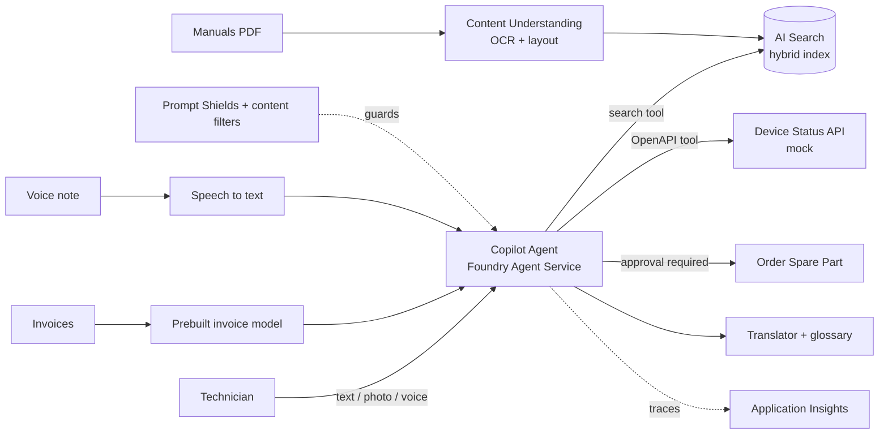

# Field Service Copilot

An AI assistant for technicians who maintain industrial equipment. Built on **Microsoft Foundry** and Azure AI services, keyless end to end (Microsoft Entra ID, no API keys in code).

> Status: 🚧 in progress (Oct–Nov 2026). Built alongside preparation for Microsoft AI-103 (Azure AI Apps and Agents Developer Associate).

## What it does

| Use case | Azure services | Status |
|---|---|---|
| Ask questions about equipment manuals, with cited answers | AI Search (hybrid + semantic ranker), Foundry model, RAG | ⬜ |
| Extract vendor, date, total and line items from scanned invoices | Document Intelligence prebuilt invoice / Content Understanding | ⬜ |
| Agent checks device status, drafts a work order, orders a spare part | Foundry Agent Service, OpenAPI tool, structured outputs, human approval | ⬜ |
| Technician uploads a photo of a damaged part | Multimodal image understanding | ⬜ |
| Summarize an inspection video into searchable segments | Content Understanding video analyzer | ⬜ |
| Voice note → report → translated for another site | Speech (phrase list), Translator (glossary), text-to-speech | ⬜ |
| Run it safely and measurably | Prompt Shields, content filters, evaluations, tracing, CI quality gate | ⬜ |

## Architecture



## Design decisions

Why each service was chosen over the alternatives. Full log in [docs/decisions.md](docs/decisions.md).

- **Keyless auth (Entra ID + RBAC)** — no secrets in code or config; least-privilege data roles.
- **Hybrid search** — technicians search by exact part numbers *and* natural-language symptoms.
- _(added as the build progresses)_

## Repository layout

```
src/
  common/          shared config and keyless clients
  01_foundation/   first keyless model call
  02_rag/          manual ingestion + RAG
  03_guardrails/   Prompt Shields, structured outputs
  04_agent/        agent, tools, approval gate
  05_evals/        evaluations + tracing
  06_extraction/   invoices + Content Understanding
  07_vision/       photos, image editing, video
  08_speech/       speech, translation
data/              sample inputs (no real customer data)
docs/              architecture and decision records
.github/workflows/ CI evaluation gate
```

## Getting started

Prerequisites: Python 3.11+, Azure CLI, an Azure subscription with a Foundry project.

```bash
python -m venv .venv
source .venv/bin/activate        # Windows: .venv\Scripts\activate
pip install -r requirements.txt
cp .env.example .env             # fill in your project endpoint and deployment names
az login
python src/01_foundation/hello_foundry.py
```

If you get a 401/403, assign yourself the **Foundry User** role (formerly "Azure AI User") on the Foundry resource. Subscription Owner manages resources but does not grant data access.

## Cost controls

Built to run on an Azure free account. Standard deployments only (no provisioned throughput), free tiers where available, a budget alert, and one resource group deleted at the end.

## Demo

_Video link added after the build is complete._

## License

MIT
